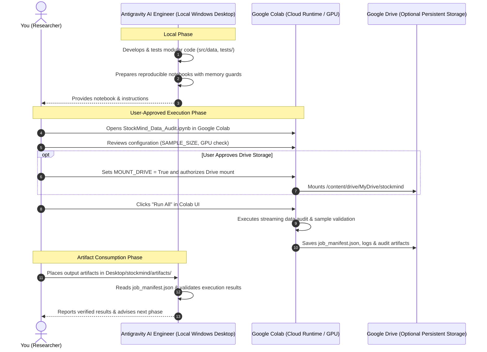

# StockMind AI: Google Colab Research & Compute Workflow

This directory contains cloud-ready Jupyter notebooks designed for reproducible data auditing, sample cleaning, and GPU-accelerated modeling in **Google Colab**.

---

## 1. Notebook Catalog

| Notebook | Purpose | Target Environment | Default Mode |
|---|---|---|---|
| [`01_Train_StockMind_Forecaster.ipynb`](file:///c:/Users/khush/OneDrive/Desktop/stockmind/notebooks/01_Train_StockMind_Forecaster.ipynb) | **Model 1: StockMind Predictor** — Chronological train/val/test split, baselines (Zero, Momentum, Ridge) vs LightGBM, artifact export for PaperTradex | Google Colab Free (Standard CPU or T4) | Isolated Preprocessing & Out-of-Sample Test |
| [`StockMind_BigData_GenAI_Pipeline.ipynb`](file:///c:/Users/khush/OneDrive/Desktop/stockmind/notebooks/StockMind_BigData_GenAI_Pipeline.ipynb) | End-to-end big data PyArrow scan (3.9M+ trades), computer vision pattern classifier, and Grok-2 multimodal grounding | NVIDIA T4 / A100 GPU or CPU | Full Big Data & Multimodal GenAI |
| [`StockMind_Data_Audit.ipynb`](file:///c:/Users/khush/OneDrive/Desktop/stockmind/notebooks/StockMind_Data_Audit.ipynb) | Hardware & memory diagnostic, streaming data audit, and dataset integrity check | Standard CPU or T4/A100 GPU | Sample / Lightweight out-of-core scan |
| [`StockMind_Compute_Worker.ipynb`](file:///c:/Users/khush/OneDrive/Desktop/stockmind/notebooks/StockMind_Compute_Worker.ipynb) | Reusable compute worker for approved data processing, cleaning, and model jobs | Standard CPU or T4/A100 GPU | Chunked batch (`SAMPLE_SIZE=1000`) |

---

## 2. Antigravity & Google Colab Integration Architecture

> [!IMPORTANT]
> **Engineering Reality & Execution Boundary:**  
> Antigravity operates locally inside your development workspace. It **does not claim or simulate autonomous remote execution** of Google Colab runtimes, which require your Google account authentication in a private browser session. Instead, Antigravity acts as your lead AI engineer: preparing robust, tested code, while you maintain complete sovereign control over cloud execution.

---

## 3. Step-by-Step: How to Run the First Notebook in Google Colab

Follow these exact steps to execute [`StockMind_Data_Audit.ipynb`](file:///c:/Users/khush/OneDrive/Desktop/stockmind/notebooks/StockMind_Data_Audit.ipynb):

### Step 1: Open Google Colab
1. Open your web browser and navigate to: **[https://colab.research.google.com/](https://colab.research.google.com/)**
2. Sign in with your Google account.

### Step 2: Upload the Notebook
1. In the Colab modal dialog, select the **Upload** tab.
2. Click **Browse** and navigate to your local project folder:  
   `Desktop/stockmind/notebooks/StockMind_Data_Audit.ipynb`
3. Click **Open**. Colab will upload and display the notebook.

### Step 3: Select Runtime Type (Optional GPU)
1. In the Colab menu bar, click **Runtime** > **Change runtime type**.
2. For the initial audit, **CPU** is completely sufficient (and saves your free Colab GPU compute units).
3. If you want to test CUDA detection, select **T4 GPU** under Hardware accelerator, then click **Save**.

### Step 4: Run the Notebook Cells
1. In Colab, click **Runtime** > **Run all** (or press `Ctrl + F9`).
2. Observe the live execution outputs:
   - **Hardware diagnostic:** Displays your Colab instance RAM, CPU cores, and GPU status.
   - **Dependency check:** Automatically installs `pyarrow`, `pandas`, and `openpyxl`.
   - **Audit execution:** Safely streams Parquet and CSV metadata.
   - **Artifact generation:** Creates `colab_audit_report.json` in `artifacts/colab_audit/`.

### Step 5: Syncing Artifacts Back to Antigravity
1. In the left sidebar of Google Colab, click the **Folder icon** (`Files`).
2. Expand `artifacts/colab_audit/`.
3. Right-click `colab_audit_report.json` and select **Download**.
4. Move the downloaded file into your local project directory:  
   `C:\Users\khush\OneDrive\Desktop\stockmind\artifacts\colab_audit_report.json`
5. Antigravity will automatically inspect the verified report and guide the next modeling steps.

---

## 4. Reusable Compute Worker (`StockMind_Compute_Worker.ipynb`)

When running heavier data-cleaning jobs or model training:
1. Open [`StockMind_Compute_Worker.ipynb`](file:///c:/Users/khush/OneDrive/Desktop/stockmind/notebooks/StockMind_Compute_Worker.ipynb) in Colab.
2. Adjust `CONFIG["SAMPLE_SIZE"]` (default is 1,000 records).
3. Execute the worker.
4. The worker writes a timestamped `job_manifest.json` with execution duration, peak RAM usage, and output artifact paths for full auditability.
